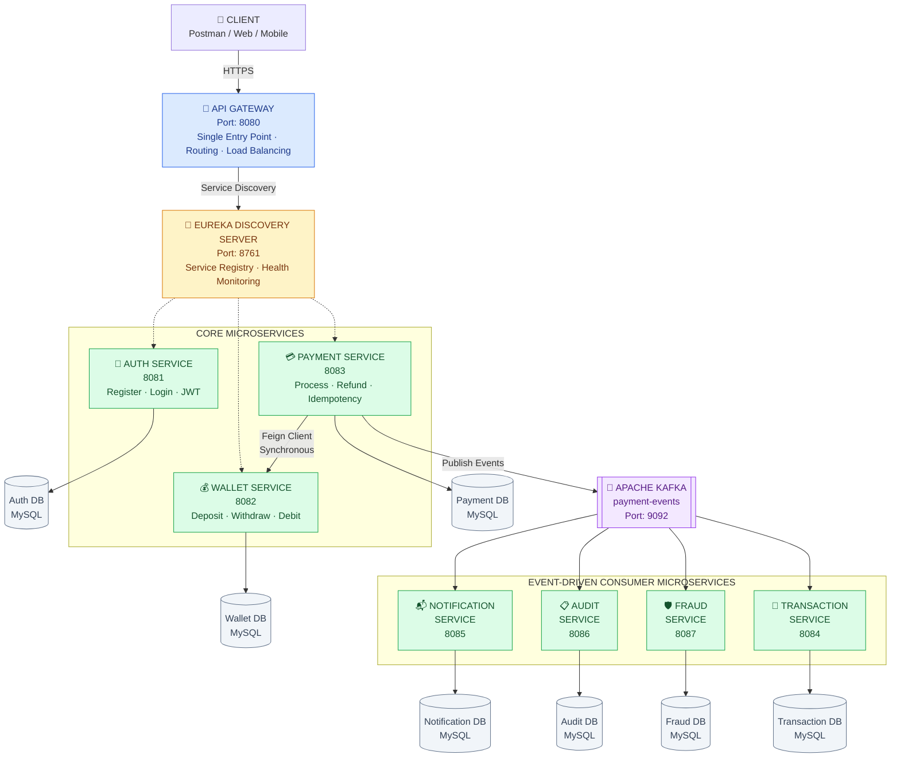
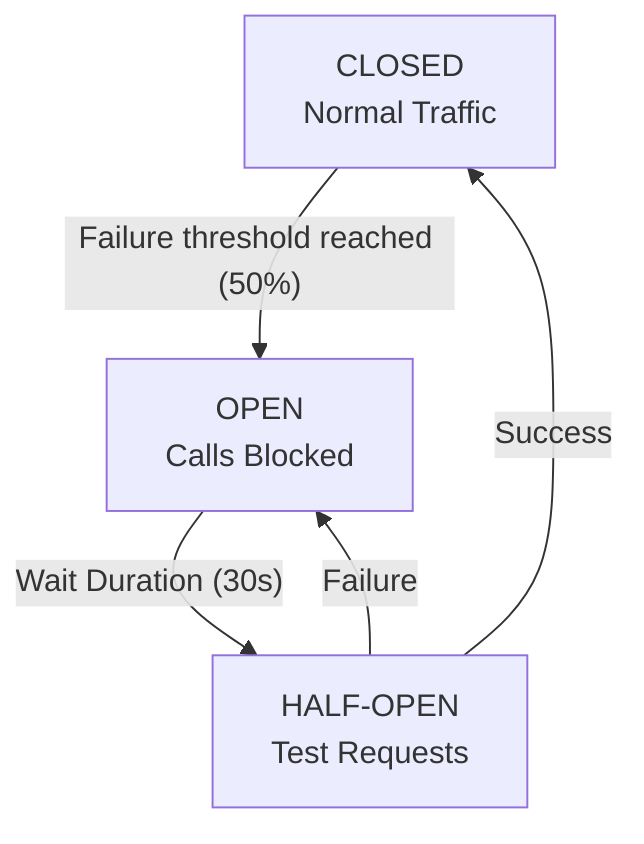
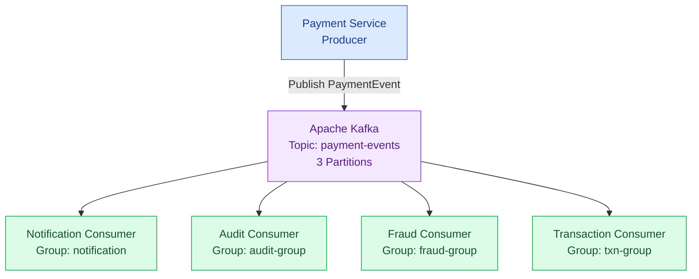

<div align="center">

# 🚀 NEXORA

### **A Connected Financial Transaction Ecosystem**

[](https://spring.io/projects/spring-boot)
[](https://www.oracle.com/java/)
[](https://kafka.apache.org/)
[](https://www.mysql.com/)
[](https://github.com/Netflix/eureka)
[](https://resilience4j.readme.io/)
[](LICENSE)
[]()
[]()

**A production-grade, event-driven, fault-tolerant microservices platform for digital wallets, payments, and financial transactions.**

*Built with Java 17 • Spring Boot 4 • Spring Cloud • Apache Kafka • Resilience4j • MySQL*

[Architecture](#-architecture) • [Features](#-features) • [Getting Started](#-getting-started) • [API Docs](#-api-documentation) • [Tech Stack](#-tech-stack)

</div>

---

## 📖 Table of Contents

1. [What is NEXORA?](#-what-is-nexora)
2. [The Problem NEXORA Solves](#-the-problem-nexora-solves)
3. [Architecture](#-architecture)
4. [Microservices Overview](#-microservices-overview)
5. [Key Features](#-key-features)
6. [Tech Stack](#-tech-stack)
7. [System Design Decisions](#-system-design-decisions)
8. [Event-Driven Architecture](#-event-driven-architecture)
9. [Fault Tolerance & Resilience](#-fault-tolerance--resilience)
10. [Database Design](#-database-design)
11. [API Documentation](#-api-documentation)
12. [Getting Started](#-getting-started)
13. [Testing](#-testing)
14. [Project Structure](#-project-structure)
15. [Roadmap](#-roadmap)
16. [Contributing](#-contributing)
17. [License](#-license)
18. [Author](#-author)

---

## 🎯 What is NEXORA?

**NEXORA** = **Nexus** (connection / central point) + **Aura** (ecosystem / surrounding system)

NEXORA is a **fintech-grade microservices platform** that simulates a complete digital payment ecosystem. It handles:

- **User identity** and authentication (JWT-based)
- **Digital wallets** with concurrency-safe balance updates
- **Payments** with idempotency and lifecycle management
- **Transactions** as an immutable financial ledger
- **Notifications** via async event processing
- **Audit logs** for complete traceability
- **Fraud detection** with real-time risk scoring

**NEXORA is not a tutorial project.** It implements the patterns used by real payment gateways (Stripe, Razorpay, PayPal) — circuit breakers, event-driven flows, idempotency, optimistic locking, distributed transactions, and comprehensive auditing.

---

## 🧩 The Problem NEXORA Solves

Consider **Rahul** — a user who has ₹10,000 in his NEXORA wallet and wants to pay ₹7,000 to a merchant.

At first glance, this looks like a simple payment. **But a real financial system must handle:**

| # | Problem | How NEXORA Solves It |
|---|---------|----------------------|
| 1 | Duplicate payment prevention | Idempotency via `referenceId` unique constraint |
| 2 | Incorrect balance deduction | Optimistic locking (`@Version`) on wallet |
| 3 | Concurrent transactions | Optimistic locking + retry mechanism |
| 4 | Payment failure recovery | Retry + Circuit Breaker + Fallback |
| 5 | Transaction consistency | ACID transactions per service |
| 6 | Complete transaction history | Immutable ledger in Transaction Service |
| 7 | Merchant settlement | Extensible merchant model |
| 8 | Refund management | Refund lifecycle in Payment Service |
| 9 | Fraud detection | Real-time risk scoring engine |
| 10 | Async notifications | Kafka-based event consumers |
| 11 | Service failure isolation | Bulkhead pattern + Circuit Breaker |
| 12 | Retry & failure handling | Resilience4j with exponential backoff |
| 13 | Complete auditability | Dedicated Audit Service |
| 14 | Secure auth | JWT access + refresh tokens, BCrypt |
| 15 | Idempotent processing | ReferenceId-based deduplication |
| 16 | Financial reconciliation | BalanceAfter recorded per transaction |
| 17 | Scalable processing | Kafka partitions + horizontal scaling |
| 18 | Reliable inter-service comm | Feign + Eureka + Load Balancing |
| 19 | Real-time status tracking | Payment status lifecycle |
| 20 | Wallet security | Freeze/Unfreeze + status validation |

---

## 🏗️ Architecture

### **High-Level System Architecture**

NEXORA follows a **microservices architecture** with a **service-per-database** pattern, **event-driven communication** via Kafka, and **resilient service-to-service calls** using Feign + Resilience4j.

<br/>


<div align="center">



</div>


<br/>


### **Communication Patterns**

| Type | Pattern | Example |
|------|---------|---------|
| **Synchronous** | REST via Feign | Payment Service → Wallet Service (debit) |
| **Asynchronous** | Kafka events | Payment Service → [Notification, Audit, Fraud, Transaction] |
| **Service Discovery** | Eureka | All services register & discover |
| **Load Balancing** | Spring Cloud LB | Feign uses `lb://service-name` |

---

## 🧱 Microservices Overview

### **1. 🔐 Auth Service** (`:8081`)

**Responsibility:** Identity, authentication, authorization.

| Feature | Description |
|---------|-------------|
| User Registration | With role assignment (USER, ADMIN, MERCHANT, SUPPORT) |
| Login | BCrypt password verification + JWT issuance |
| JWT Access Token | 15-minute expiry |
| Refresh Token | 7-day expiry for token rotation |
| Logout | Token invalidation |
| Role-Based Access | Spring Security with `ROLE_*` authorities |
| Account Status | ACTIVE, LOCKED, SUSPENDED, PENDING_VERIFICATION |

**Tech:** Spring Security 7, JJWT 0.13.0, BCrypt

---

### **2. 💰 Wallet Service** (`:8082`)

**Responsibility:** Digital wallet management with concurrency-safe operations.

| Feature | Description |
|---------|-------------|
| Create Wallet | One wallet per user |
| Deposit | Credit money into wallet |
| Withdraw | Debit money with balance check |
| Internal Debit | Called by Payment Service (Feign) |
| Transaction History | Full audit of wallet movements |
| Balance Snapshot | `balanceAfter` per transaction |
| Optimistic Locking | `@Version` prevents race conditions |
| Idempotency | ReferenceId-based deduplication |

**Tech:** JPA with `@Version`, BigDecimal for money

---

### **3. 💳 Payment Service** (`:8083`)

**Responsibility:** Payment lifecycle orchestration.

| Feature | Description |
|---------|-------------|
| Create Payment | With idempotency check |
| Process Payment | PENDING → PROCESSING |
| Update Status | PROCESSING → SUCCESS/FAILED |
| Cancel Payment | Only PENDING can be cancelled |
| Wallet Integration | Feign call to Wallet Service |
| Fault Tolerance | Circuit Breaker + Retry + Fallback |
| Event Publishing | Kafka `payment-events` topic |

**Tech:** Feign, Resilience4j, Kafka Producer

---

### **4. 📒 Transaction Service** (`:8084`)

**Responsibility:** Immutable financial ledger.

| Feature | Description |
|---------|-------------|
| Ledger Entry | Created for every successful payment |
| Balance Before/After | Complete financial trace |
| Transaction Type | CREDIT / DEBIT |
| Source Tracking | PAYMENT, WITHDRAWAL, DEPOSIT, REFUND |
| Event Consumer | Consumes `PAYMENT_SUCCESS` events |
| Idempotency | ReferenceId-based deduplication |

**Tech:** Kafka Consumer, JPA

---

### **5. 📬 Notification Service** (`:8085`)

**Responsibility:** Async notifications via multiple channels.

| Feature | Description |
|---------|-------------|
| Multi-channel | EMAIL, SMS, PUSH, IN_APP |
| Event-Driven | Consumes payment events from Kafka |
| Status Tracking | PENDING, SENT, FAILED |
| Retry Mechanism | Failed notifications can be retried |
| Reference Linking | Notifications linked to payments |

**Tech:** Kafka Consumer, JPA

---

### **6. 📋 Audit Service** (`:8086`)

**Responsibility:** Complete audit trail for compliance.

| Feature | Description |
|---------|-------------|
| Multi-source Audit | All services can push audit logs |
| Action Tracking | USER_REGISTERED, PAYMENT_SUCCESS, etc. |
| Status | SUCCESS / FAILURE |
| IP & User Agent | Security context captured |
| Date Range Queries | Compliance reporting |
| Event Consumer | Auto-audits payment events |

**Tech:** Kafka Consumer, JPA

---

### **7. 🛡️ Fraud Detection Service** (`:8087`)

**Responsibility:** Real-time risk scoring and fraud prevention.

| Feature | Description |
|---------|-------------|
| Risk Scoring | 0-100 score based on rules |
| Risk Levels | LOW, MEDIUM, HIGH, CRITICAL |
| Decisions | ALLOW, REVIEW, BLOCK |
| Amount Rules | HIGH_AMOUNT, VERY_HIGH_AMOUNT |
| Velocity Check | Transactions per hour |
| Frequency Check | Transactions per day |
| Event Consumer | Auto-checks payment events |

**Tech:** Kafka Consumer, Rule Engine

---

## ⚡ Key Features

<table>
<tr>
<td width="50%">

### 🎯 Core Features
- ✅ JWT Authentication with refresh tokens
- ✅ Role-Based Access Control (RBAC)
- ✅ Digital wallet with concurrency safety
- ✅ Payment lifecycle management
- ✅ Idempotent payment processing
- ✅ Immutable financial ledger
- ✅ Multi-channel notifications
- ✅ Complete audit trail
- ✅ Real-time fraud detection

</td>
<td width="50%">

### 🔥 Advanced Features
- ✅ Circuit Breaker (Resilience4j)
- ✅ Retry with exponential backoff
- ✅ Timeout protection
- ✅ Graceful fallback
- ✅ Event-driven architecture (Kafka)
- ✅ Fan-out pattern (1 event → 4 consumers)
- ✅ Service discovery (Eureka)
- ✅ API Gateway routing
- ✅ Optimistic locking

</td>
</tr>
</table>

---

## 🛠️ Tech Stack

### **Backend**

| Layer | Technology |
|-------|-----------|
| Language | Java 17 |
| Framework | Spring Boot 4.0.8 |
| Cloud | Spring Cloud 2025.1.3 |
| Security | Spring Security 7 + JJWT 0.13.0 |
| Persistence | Spring Data JPA + Hibernate 7 |
| Database | MySQL 8.0 |
| Event Streaming | Apache Kafka 4.1.2 |
| Service Discovery | Netflix Eureka |
| API Gateway | Spring Cloud Gateway |
| REST Client | OpenFeign |
| Resilience | Resilience4j 2.2.0 |
| Build Tool | Maven |
| Boilerplate | Lombok 1.18.46 |

### **Infrastructure**

| Component | Version | Port |
|-----------|---------|------|
| Eureka Server | Spring Cloud | 8761 |
| API Gateway | Spring Cloud Gateway | 8080 |
| Kafka Broker | Confluent 4.1.2 | 9092 |
| Zookeeper | Confluent | 2181 |
| Kafka UI | Provectus | 9090 |
| MySQL | 8.0.42 | 3306 |

---

## 🧠 System Design Decisions

### **1. Database Per Service Pattern**

Each microservice owns its database:

| Service | Database |
|---------|----------|
| Auth | `nexora_auth` |
| Wallet | `nexora_wallet` |
| Payment | `nexora_payment` |
| Transaction | `nexora_transaction` |
| Notification | `nexora_notification` |
| Audit | `nexora_audit` |
| Fraud | `nexora_fraud` |

**Why?**
- ✅ Loose coupling
- ✅ Independent schema evolution
- ✅ Service-specific optimization
- ✅ Fault isolation

---

### **2. Idempotency via ReferenceId**

Every critical operation uses a unique `referenceId`:

```java
// Payment creation
if (paymentRepository.findByReferenceId(request.getReferenceId()).isPresent()) {
    throw new PaymentAlreadyExistsException(request.getReferenceId());
}
```
Why?

✅ Prevents duplicate payments

✅ Enables safe retries

✅ Network failure recovery

✅ At-most-once processing

Optimistic Locking
Wallet entity uses @Version:

```aiignore
@Version
private Long version = 0L;
```
Why?

✅ Prevents lost updates

✅ Handles concurrent balance changes

✅ No database locks

✅ Better scalability

4. Event-Driven Architecture
   Payment Service publishes events; consumers react independently:
```aiignore
Payment → Kafka → [Notification, Audit, Fraud, Transaction]
```
Why?

✅ Decouples services

✅ Async processing

✅ Fault tolerance

✅ Scalable consumers


### 5. Resilience4j for Fault Tolerance

The Payment Service uses **Resilience4j** to make Payment → Wallet communication more reliable and prevent failures from propagating across services.

#### Fault-Tolerance Patterns

| Pattern | Purpose |
| :--- | :--- |
| **Circuit Breaker** | Prevent cascading failures when Wallet Service is unavailable |
| **Retry** | Automatically retry transient failures |
| **Timeout** | Prevent requests from hanging indefinitely |
| **Fallback** | Provide a graceful response when the Wallet Service cannot be reached |

#### Circuit Breaker States

The Circuit Breaker operates in three main states:




## 📨 Event-Driven Architecture

The Payment Service uses **Apache Kafka** for asynchronous, event-driven communication between services.

### **Kafka Topic: `payment-events`**

| Property | Value |
| :--- | :--- |
| **Topic Name** | `payment-events` |
| **Partitions** | 3 |
| **Replication Factor** | 1 |
| **Key** | `paymentId` |
| **Value** | `PaymentEvent` (JSON) |

### **Event Flow**




### **Event Types**

| **Event Type** | **Trigger** | **Consumers React** |
| :--- | :--- | :--- |
| `PAYMENT_CREATED` | Payment created | Audit, Fraud |
| `PAYMENT_PROCESSING` | Payment processing | Notification |
| `PAYMENT_SUCCESS` | Payment succeeded | **All** (Txn Ledger, Notification, Audit, Fraud) |
| `PAYMENT_FAILED` | Payment failed | Notification, Audit |
| `PAYMENT_CANCELLED` | Payment cancelled | Notification, Audit |
| `PAYMENT_REFUNDED` | Payment refunded | Notification, Audit |

🛡️ Fault Tolerance & Resilience
Resilience4j Configuration

```aiignore
Circuit Breaker:
  failureRateThreshold: 50%
  slidingWindowSize: 10
  minimumNumberOfCalls: 5
  waitDurationInOpenState: 30s
  permittedNumberOfCallsInHalfOpenState: 3

Retry:
  maxAttempts: 3
  waitDuration: 500ms
  retryExceptions:
    - IOException
    - FeignException.ServiceUnavailable
    - FeignException.GatewayTimeout

Time Limiter:
  timeoutDuration: 3s
```
Live Test Evidence

Test: Wallet Service DOWN

```aiignore
[RESILIENCE] Calling Wallet Service... (attempt 1)
[RESILIENCE] No servers available for service: wallet-service
[RESILIENCE] Calling Wallet Service... (attempt 2 - RETRY)
[RESILIENCE] No servers available for service: wallet-service
[RESILIENCE] Calling Wallet Service... (attempt 3 - RETRY)
[RESILIENCE] No servers available for service: wallet-service
[RESILIENCE] Wallet Service call FAILED. CircuitBreaker state: CLOSED
[RESILIENCE] FALLBACK triggered for walletId: c3badf64-...
[PAYMENT-SERVICE] Wallet debit failed: Wallet Service is temporarily unavailable
```
Test: Circuit Breaker Opened
```aiignore
Second request:
[RESILIENCE] Wallet Service call FAILED. CircuitBreaker state: OPEN
[RESILIENCE] FALLBACK triggered
```
Test: Circuit Recovered (Wallet UP)

```aiignore
[WALLET-INTERNAL] Internal debit request ... success: true
[WALLET-SERVICE] Balance updated: oldBalance: 2200, newBalance: 2000
[RESILIENCE] Wallet Service call successful. CircuitBreaker state: CLOSED
```
### **Resilience Patterns Matrix**

| **Pattern** | **Where Used** | **Benefit** |
| :--- | :--- | :--- |
| **Circuit Breaker** | Payment → Wallet | Prevent cascading failures |
| **Retry** | Payment → Wallet | Handle transient failures |
| **Timeout** | Payment → Wallet | Prevent hanging |
| **Fallback** | Payment → Wallet | Graceful degradation |
| **Idempotency** | All financial operations | Duplicate prevention |
| **Optimistic Lock** | Wallet updates | Concurrency safety |
| **DLQ (planned)** | Kafka consumers | Failed message handling |

---

## 🗄️ Database Design

### **Auth Service — `nexora_auth`**

```aiignore
-- users table
CREATE TABLE users (
    id VARCHAR(255) PRIMARY KEY,
    username VARCHAR(50) UNIQUE NOT NULL,
    email VARCHAR(100) UNIQUE NOT NULL,
    password VARCHAR(255) NOT NULL,
    account_status ENUM('ACTIVE','INACTIVE','LOCKED','SUSPENDED','PENDING_VERIFICATION') NOT NULL,
    is_active BIT NOT NULL,
    version BIGINT NOT NULL,
    created_at DATETIME NOT NULL,
    updated_at DATETIME NOT NULL
);

-- roles table
CREATE TABLE roles (
    id VARCHAR(255) PRIMARY KEY,
    name ENUM('USER','ADMIN','MERCHANT','SUPPORT') UNIQUE NOT NULL,
    description VARCHAR(200)
);

-- user_roles (many-to-many)
CREATE TABLE user_roles (
    user_id VARCHAR(255),
    role_id VARCHAR(255),
    PRIMARY KEY (user_id, role_id),
    FOREIGN KEY (user_id) REFERENCES users(id),
    FOREIGN KEY (role_id) REFERENCES roles(id)
);
```
### **Wallet Service — `nexora_wallet`**
```aiignore
CREATE TABLE wallets (
    id VARCHAR(255) PRIMARY KEY,
    user_id VARCHAR(255) NOT NULL UNIQUE,
    balance DECIMAL(19,2) NOT NULL DEFAULT 0.00,
    status ENUM('ACTIVE','FROZEN','CLOSED') NOT NULL,
    version BIGINT NOT NULL,
    created_at DATETIME NOT NULL,
    updated_at DATETIME NOT NULL
);

CREATE TABLE wallet_transactions (
    id VARCHAR(255) PRIMARY KEY,
    wallet_id VARCHAR(255) NOT NULL,
    reference_id VARCHAR(50) UNIQUE NOT NULL,
    type ENUM('CREDIT','DEBIT') NOT NULL,
    amount DECIMAL(19,2) NOT NULL,
    balance_after DECIMAL(19,2) NOT NULL,
    description VARCHAR(100),
    status ENUM('PENDING','SUCCESS','FAILED') NOT NULL,
    version BIGINT NOT NULL,
    created_at DATETIME NOT NULL,
    updated_at DATETIME NOT NULL
);
```
### **Payment Service — `nexora_payment`**
```aiignore
CREATE TABLE payments (
    id VARCHAR(255) PRIMARY KEY,
    user_id VARCHAR(255) NOT NULL,
    wallet_id VARCHAR(255) NOT NULL,
    reference_id VARCHAR(50) UNIQUE NOT NULL,
    amount DECIMAL(19,2) NOT NULL,
    currency VARCHAR(3) NOT NULL DEFAULT 'INR',
    method ENUM('WALLET','UPI','CARD','NET_BANKING') NOT NULL,
    status ENUM('PENDING','PROCESSING','SUCCESS','FAILED','REFUNDED','CANCELLED') NOT NULL,
    description VARCHAR(200),
    failure_reason VARCHAR(255),
    transaction_id VARCHAR(50),
    version BIGINT NOT NULL,
    created_at DATETIME NOT NULL,
    updated_at DATETIME NOT NULL
);
```
### **Transaction Service — `nexora_transaction`**

```aiignore
CREATE TABLE transactions (
    id VARCHAR(255) PRIMARY KEY,
    user_id VARCHAR(255) NOT NULL,
    wallet_id VARCHAR(255) NOT NULL,
    reference_id VARCHAR(50) UNIQUE NOT NULL,
    source_id VARCHAR(50) NOT NULL,
    type ENUM('CREDIT','DEBIT') NOT NULL,
    source ENUM('PAYMENT','WITHDRAWAL','DEPOSIT','REFUND','TRANSFER') NOT NULL,
    amount DECIMAL(19,2) NOT NULL,
    balance_before DECIMAL(19,2) NOT NULL,
    balance_after DECIMAL(19,2) NOT NULL,
    description VARCHAR(200),
    status ENUM('PENDING','SUCCESS','FAILED') NOT NULL,
    failure_reason VARCHAR(255),
    version BIGINT NOT NULL,
    created_at DATETIME NOT NULL,
    updated_at DATETIME NOT NULL
);
```
### **Notification Service — `nexora_notification`**
```aiignore
CREATE TABLE notifications (
    id VARCHAR(255) PRIMARY KEY,
    user_id VARCHAR(255) NOT NULL,
    reference_id VARCHAR(50) NOT NULL,
    type ENUM('PAYMENT_SUCCESS','PAYMENT_FAILED','WALLET_CREATED','TRANSACTION_SUCCESS',...) NOT NULL,
    channel ENUM('EMAIL','SMS','PUSH','IN_APP') NOT NULL,
    subject VARCHAR(200) NOT NULL,
    message VARCHAR(1000) NOT NULL,
    recipient VARCHAR(100),
    status ENUM('PENDING','SENT','FAILED') NOT NULL,
    failure_reason VARCHAR(255),
    version BIGINT NOT NULL,
    created_at DATETIME NOT NULL,
    updated_at DATETIME NOT NULL
);
```
Audit Service — nexora_audit
```aiignore
CREATE TABLE audit_logs (
    id VARCHAR(255) PRIMARY KEY,
    user_id VARCHAR(50) NOT NULL,
    reference_id VARCHAR(50) NOT NULL,
    action ENUM('USER_REGISTERED','PAYMENT_SUCCESS','WALLET_DEPOSIT',...) NOT NULL,
    source ENUM('AUTH_SERVICE','WALLET_SERVICE','PAYMENT_SERVICE',...) NOT NULL,
    status ENUM('SUCCESS','FAILURE') NOT NULL,
    details VARCHAR(1000),
    ip_address VARCHAR(100),
    user_agent VARCHAR(100),
    failure_reason VARCHAR(255),
    version BIGINT NOT NULL,
    created_at DATETIME NOT NULL,
    updated_at DATETIME NOT NULL
);
```
### **Fraud Service — `nexora_fraud`**

```aiignore
CREATE TABLE fraud_assessments (
    id VARCHAR(255) PRIMARY KEY,
    user_id VARCHAR(50) NOT NULL,
    reference_id VARCHAR(50) NOT NULL,
    transaction_id VARCHAR(50) NOT NULL,
    amount DECIMAL(19,2) NOT NULL,
    risk_score INT NOT NULL,
    risk_level ENUM('LOW','MEDIUM','HIGH','CRITICAL') NOT NULL,
    decision ENUM('ALLOW','REVIEW','BLOCK') NOT NULL,
    status ENUM('PENDING','COMPLETED','FAILED') NOT NULL,
    details VARCHAR(1000),
    ip_address VARCHAR(100),
    user_agent VARCHAR(100),
    failure_reason VARCHAR(255),
    version BIGINT NOT NULL,
    created_at DATETIME NOT NULL,
    updated_at DATETIME NOT NULL
);
```

# 📡 API Documentation

## 🔐 Auth Service — `/api/auth/**`

| Method | Endpoint | Description |
| :--- | :--- | :--- |
| POST | `/api/auth/register` | Register new user |
| POST | `/api/auth/login` | Login & get JWT |
| POST | `/api/auth/refresh` | Refresh access token |
| POST | `/api/auth/logout` | Logout user |

### Example: Register

```bash
curl -X POST http://localhost:8080/api/auth/register \
  -H "Content-Type: application/json" \
  -d '{
    "username": "rahul",
    "email": "rahul@nexora.com",
    "password": "Rahul@1234"
  }'
```
### 5. Resilience4j for Fault Tolerance

The Payment Service uses **Resilience4j** to make Payment → Wallet communication more reliable and prevent failures from propagating across services.

#### Fault-Tolerance Patterns

| Pattern | Purpose |
| :--- | :--- |
| **Circuit Breaker** | Prevent cascading failures when Wallet Service is unavailable |
| **Retry** | Automatically retry transient failures |
| **Timeout** | Prevent requests from hanging indefinitely |
| **Fallback** | Provide a graceful response when the Wallet Service cannot be reached |

#### Circuit Breaker States

The Circuit Breaker operates in three main states:


flowchart TD
    CLOSED["CLOSED<br/>Normal Traffic"]
    OPEN["OPEN<br/>Calls Blocked"]
    HALF["HALF-OPEN<br/>Test Requests"]

    CLOSED -->|"Failure threshold reached"| OPEN
    OPEN -->|"Wait Duration"| HALF
    HALF -->|"Success"| CLOSED
    HALF -->|"Failure"| OPEN

### **Payment Service — `/api/payments/**`**

| **Method** | **Endpoint** | **Description** |
| :--- | :--- | :--- |
| POST | `/api/payments` | Create payment |
| GET | `/api/payments/{id}` | Get payment by ID |
| GET | `/api/payments/reference/{refId}` | Get by reference |
| GET | `/api/payments/user/{userId}` | Get user payments |
| GET | `/api/payments/wallet/{walletId}` | Get wallet payments |
| POST | `/api/payments/{id}/process` | Process payment |
| PATCH | `/api/payments/{id}/status` | Update status |
| POST | `/api/payments/{id}/cancel` | Cancel payment |

### **Transaction Service — `/api/transactions/**`**

| **Method** | **Endpoint** | **Description** |
| :--- | :--- | :--- |
| POST | `/api/transactions` | Create transaction |
| GET | `/api/transactions/{id}` | Get by ID |
| GET | `/api/transactions/reference/{refId}` | Get by reference |
| GET | `/api/transactions/user/{userId}` | Get user transactions |
| GET | `/api/transactions/wallet/{walletId}` | Get wallet transactions |
| PATCH | `/api/transactions/{id}/status` | Update status |


### **Notification Service — `/api/notifications/**`**

| **Method** | **Endpoint** | **Description** |
| :--- | :--- | :--- |
| POST | `/api/notifications` | Create notification |
| GET | `/api/notifications/{id}` | Get by ID |
| GET | `/api/notifications/user/{userId}` | Get user notifications |
| GET | `/api/notifications/user/{userId}/status/{status}` | Filter by status |
| POST | `/api/notifications/{id}/retry` | Retry notification |
| POST | `/api/notifications/retry-failed` | Retry all failed |

### **Audit Service — `/api/audit-logs/**`**

| **Method** | **Endpoint** | **Description** |
| :--- | :--- | :--- |
| POST | `/api/audit-logs` | Create audit log |
| GET | `/api/audit-logs/{id}` | Get by ID |
| GET | `/api/audit-logs/user/{userId}` | Get user audits |
| GET | `/api/audit-logs/reference/{refId}` | Get by reference |
| GET | `/api/audit-logs/action/{action}` | Filter by action |
| GET | `/api/audit-logs/source/{source}` | Filter by service |
| GET | `/api/audit-logs/status/{status}` | Filter by status |
| GET | `/api/audit-logs/date-range` | Date range query |

### **Fraud Detection Service — `/api/fraud/**`**

| **Method** | **Endpoint** | **Description** |
| :--- | :--- | :--- |
| POST | `/api/fraud/check` | Run fraud check |
| GET | `/api/fraud/{id}` | Get by ID |
| GET | `/api/fraud/reference/{refId}` | Get by reference |
| GET | `/api/fraud/user/{userId}` | Get user assessments |
| GET | `/api/fraud/decision/{decision}` | Filter by decision |
| GET | `/api/fraud/risk-level/{level}` | Filter by risk |
| GET | `/api/fraud/date-range` | Date range query |

## 🚀 Getting Started

### **Prerequisites**

- ✅ Java 17+
- ✅ Maven 3.8+
- ✅ MySQL 8.0+
- ✅ Docker (for Kafka)
- ✅ Postman (for testing)

### **Step 1: Start Infrastructure**

**MySQL:**

```aiignore
# Ensure MySQL running on localhost:3306
mysql -u root -p
CREATE DATABASE IF NOT EXISTS nexora_auth;
CREATE DATABASE IF NOT EXISTS nexora_wallet;
CREATE DATABASE IF NOT EXISTS nexora_payment;
CREATE DATABASE IF NOT EXISTS nexora_transaction;
CREATE DATABASE IF NOT EXISTS nexora_notification;
CREATE DATABASE IF NOT EXISTS nexora_audit;
CREATE DATABASE IF NOT EXISTS nexora_fraud;
```
**Kafka + Zookeeper + Kafka UI:**
```aiignore
docker run -d --name zookeeper -p 2181:2181 confluentinc/cp-zookeeper:latest
docker run -d --name kafka -p 9092:9092 \
  --link zookeeper \
  -e KAFKA_ZOOKEEPER_CONNECT=zookeeper:2181 \
  -e KAFKA_ADVERTISED_LISTENERS=PLAINTEXT://localhost:9092 \
  confluentinc/cp-kafka:latest
docker run -d --name kafka-ui -p 9090:8080 \
  -e KAFKA_CLUSTERS_0_NAME=local \
  -e KAFKA_CLUSTERS_0_BOOTSTRAPSERVERS=kafka:9092 \
  provectuslabs/kafka-ui:latest
```
**Create Kafka topic:**
```aiignore
docker exec -it kafka kafka-topics --create \
  --topic payment-events \
  --bootstrap-server localhost:9092 \
  --partitions 3 \
  --replication-factor 1
```
### **Step 2: Start Services (in order)**
```aiignore
# 1. Discovery Server (Eureka)
cd discovery-server && mvn spring-boot:run

# 2. API Gateway
cd api-gateway && mvn spring-boot:run

# 3. Auth Service
cd auth-service && mvn spring-boot:run

# 4. Wallet Service
cd wallet-service && mvn spring-boot:run

# 5. Payment Service
cd payment-service && mvn spring-boot:run

# 6. Transaction Service
cd transaction-service && mvn spring-boot:run

# 7. Notification Service
cd notification-service && mvn spring-boot:run

# 8. Audit Service
cd audit-service && mvn spring-boot:run

# 9. Fraud Service
cd fraud-detection-service && mvn spring-boot:run
```
### **Step 3: Verify Eureka Dashboard**

Open: [**http://localhost:8761**](http://localhost:8761)

You should see all 7 services + API Gateway registered with `UP` status.

### **Step 4: End-to-End Test**

**1. Register User:**

```aiignore
curl -X POST http://localhost:8080/api/auth/register \
  -H "Content-Type: application/json" \
  -d '{"username":"rahul","email":"rahul@nexora.com","password":"Rahul@1234"}'
```
**2. Login:**
```aiignore
curl -X POST http://localhost:8080/api/auth/login \
-H "Content-Type: application/json" \
-d '{"username":"rahul","password":"Rahul@1234"}'
```
**3. Create Wallet:**
```aiignore
curl -X POST http://localhost:8080/api/wallets \
  -H "X-User-Id: {userId}" \
  -H "Content-Type: application/json"
```
**4. Deposit:**

```aiignore
curl -X POST http://localhost:8080/api/wallets/{walletId}/deposit \
  -H "Content-Type: application/json" \
  -d '{"referenceId":"DEP-001","amount":5000.00}'
```
**5. Create Payment (triggers Kafka + Feign):**

```aiignore
curl -X POST http://localhost:8080/api/payments \
  -H "Content-Type: application/json" \
  -d '{
    "userId": "{userId}",
    "walletId": "{walletId}",
    "referenceId": "PAY-001",
    "amount": 500.00,
    "method": "WALLET"
  }'
```

**6. Verify:**

- ✅ Wallet balance decreased
- ✅ Payment created
- ✅ Kafka event published
- ✅ 4 consumers processed
- ✅ Notification, Audit, Fraud, Transaction logs
## 🧪 Testing

### **Manual Testing Flow**

| **Step** | **Endpoint** | **Verify** |
| :--- | :--- | :--- |
| 1 | `POST /auth/register` | User created |
| 2 | `POST /auth/login` | JWT returned |
| 3 | `POST /wallets` | Wallet created |
| 4 | `POST /wallets/{id}/deposit` | Balance increased |
| 5 | `POST /payments` | Payment + Kafka event |
| 6 | `POST /payments/{id}/process` | Status → PROCESSING |
| 7 | `PATCH /payments/{id}/status` | Status → SUCCESS |
| 8 | Check Kafka consumers | All 4 services logged |
| 9 | Check ledger | Transaction created |

### **Resilience Testing**

| **Test** | **How** | **Expected** |
| :--- | :--- | :--- |
| Normal | Wallet UP | Payment succeeds |
| Wallet DOWN | Stop Wallet Service | Retry → Fallback |
| Circuit OPEN | 5+ failures | Circuit opens |
| Circuit Recover | Start Wallet, wait 30s | Circuit closes |
| Idempotency | Same `referenceId` twice | Second returns cached |

## 📂 Project Structure

```mermaid
flowchart TB
    ROOT["NEXORA<br/>Microservices Project"]

    ROOT --> INFRA["Infrastructure"]
    ROOT --> SERVICES["Microservices"]

    INFRA --> DISC["Discovery Server<br/>Eureka · :8761"]
    INFRA --> GATE["API Gateway<br/>:8080"]

    SERVICES --> AUTH["Auth Service<br/>JWT · :8081"]
    SERVICES --> WALLET["Wallet Service<br/>:8082"]
    SERVICES --> PAYMENT["Payment Service<br/>Kafka Producer · :8083"]
    SERVICES --> TXN["Transaction Service<br/>Financial Ledger · :8084"]
    SERVICES --> NOTIF["Notification Service<br/>Kafka Consumer · :8085"]
    SERVICES --> AUDIT["Audit Service<br/>Kafka Consumer · :8086"]
    SERVICES --> FRAUD["Fraud Detection Service<br/>Kafka Consumer · :8087"]

    AUTH --> A1["config · controller · dto"]
    AUTH --> A2["entity · enums · exception"]
    AUTH --> A3["mapper · repository · security · service"]
    AUTH --> A4["src/main/resources"]

    WALLET --> W1["common · config · controller"]
    WALLET --> W2["dto · entity · enums · exception"]
    WALLET --> W3["mapper · repository · service"]
    WALLET --> W4["src/main/resources"]

    PAYMENT --> P1["client · Feign WalletClient"]
    PAYMENT --> P2["config · controller · dto"]
    PAYMENT --> P3["entity · enums · event · exception"]
    PAYMENT --> P4["mapper · producer · repository"]
    PAYMENT --> P5["resilience · service"]
    PAYMENT --> P6["src/main/resources"]

    TXN --> T1["config · consumer · controller"]
    TXN --> T2["dto · entity · enums · event"]
    TXN --> T3["exception · mapper · repository · service"]
    TXN --> T4["src/main/resources"]

    NOTIF --> N1["config · consumer · controller"]
    NOTIF --> N2["dto · entity · enums · event"]
    NOTIF --> N3["exception · mapper · repository · service"]
    NOTIF --> N4["src/main/resources"]

    AUDIT --> AU1["config · consumer · controller"]
    AUDIT --> AU2["dto · entity · enums · event"]
    AUDIT --> AU3["exception · mapper · repository · service"]
    AUDIT --> AU4["src/main/resources"]

    FRAUD --> F1["config · consumer · controller"]
    FRAUD --> F2["dto · entity · enums · event"]
    FRAUD --> F3["exception · mapper · repository · service"]
    FRAUD --> F4["src/main/resources"]

    classDef rootStyle fill:#172554,stroke:#3b82f6,color:#ffffff,stroke-width:3px
    classDef infraStyle fill:#dbeafe,stroke:#2563eb,color:#1e3a8a
    classDef serviceStyle fill:#dcfce7,stroke:#16a34a,color:#14532d
    classDef packageStyle fill:#f3f4f6,stroke:#9ca3af,color:#1f2937

    class ROOT rootStyle
    class INFRA,SERVICES infraStyle
    class DISC,GATE serviceStyle
    class AUTH,WALLET,PAYMENT,TXN,NOTIF,AUDIT,FRAUD serviceStyle
    class A1,A2,A3,A4,W1,W2,W3,W4,P1,P2,P3,P4,P5,P6,T1,T2,T3,T4,N1,N2,N3,N4,AU1,AU2,AU3,AU4,F1,F2,F3,F4 packageStyle

---

## 🗺️ Roadmap

### ✅ Completed

- ☑ Auth Service with JWT
- ☑ Wallet Service with concurrency safety
- ☑ Payment Service with idempotency
- ☑ Transaction Service (ledger)
- ☑ Notification Service
- ☑ Audit Service
- ☑ Fraud Detection Service
- ☑ API Gateway
- ☑ Eureka Service Discovery
- ☑ Kafka Integration (Producer + 4 Consumers)
- ☑ Feign Client (Payment → Wallet)
- ☑ Resilience4j (Circuit Breaker + Retry + Fallback)

### 🚧 In Progress / Planned

- □ Redis for caching & rate limiting
- □ Dead Letter Queue (DLQ) for Kafka
- □ Distributed tracing (Zipkin / Jaeger)
- □ Prometheus + Grafana monitoring
- □ Docker Compose for entire stack
- □ Kubernetes deployment manifests
- □ API documentation with Swagger/OpenAPI
- □ Integration tests with Testcontainers
- □ CI/CD pipeline (GitHub Actions)
- □ Real email/SMS integration (SendGrid, Twilio)

## 🤝 Contributing

Contributions are welcome! Please follow these steps:

1. Fork the repository
2. Create a feature branch (`git checkout -b feature/amazing-feature`)
3. Commit changes (`git commit -m 'Add amazing feature'`)
4. Push to branch (`git push origin feature/amazing-feature`)
5. Open a Pull Request

## 👨‍💻 Author

<div align="center">

### **Anshuman**

**Full Stack Developer | Java • Spring Boot • Microservices**

*"Building reliable, scalable, and fault-tolerant systems."*

[](https://github.com/AnshCyberSec)
[](https://www.linkedin.com/in/anshuman-dalabehera-a00727281/)
[](mailto:anshumananshuman63@gmail.com)

</div>

### ⭐ If this project helped you, please give it a star! ⭐

**NEXORA — Connecting Financial Ecosystems, One Transaction at a Time.**

*Built with ❤️ using Spring Boot, Kafka, and Resilience4j*

</div>
